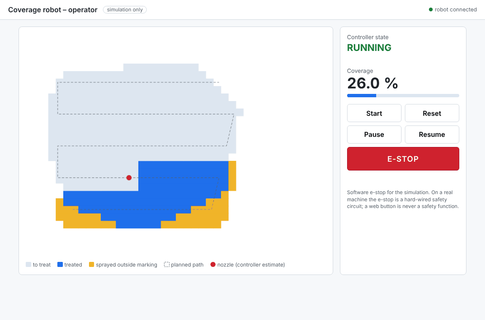
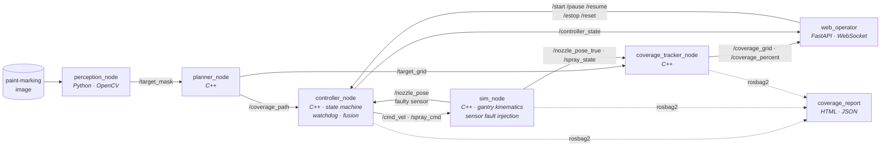
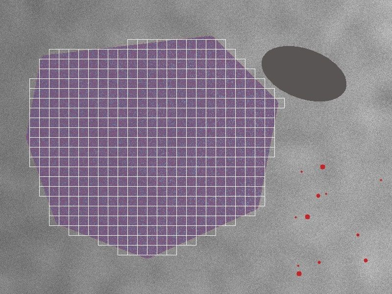
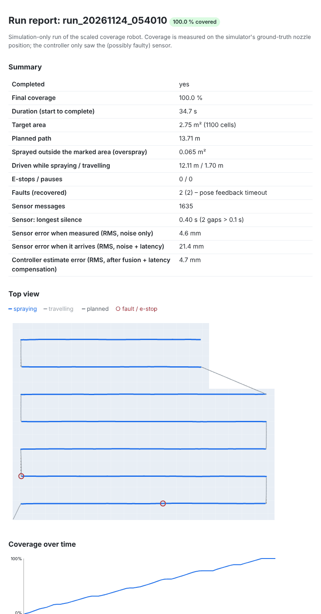

# ros2-coverage-robot-sim

[](https://github.com/SHIVCHAUDHARY17/ros2-coverage-robot-sim/actions/workflows/ci.yml)

A **simulation-only, scaled analogue of a waterjet surface-coverage robot**: a 2-axis
nozzle must treat every part of a marked area of concrete, safely, while its sensors
are noisy, late and sometimes silent. Inspired by hydrodemolition robots (high-pressure
water concrete removal). ROS 2 Jazzy, C++17 and Python, Docker, GitHub Actions.

> **No hardware is involved.** Everything here runs in a 2D kinematic simulation with
> injected sensor faults. Numbers below are measured in that simulation.



## What it does

| Step | Package | What happens |
|---|---|---|
| **Perceive** | `coverage_perception` (Python, OpenCV) | Finds the **spray-painted** removal area in a camera image and turns it into the robot's target grid |
| **Plan** | `coverage_core` + `planner_node` (C++) | Boustrophedon ("lawn-mower") coverage path over any target shape |
| **Control safely** | `coverage_core` + `controller_node` (C++) | Speed/acceleration-limited path following, state machine with e-stop, watchdogs |
| **Survive bad sensors** | `coverage_core` + `sim_node` (C++) | Noise, vibration, latency, dropped messages and blackouts are injected; the controller fuses, compensates or stops safely |
| **Operate** | `coverage_web` (Python, FastAPI) | Browser UI: start / pause / resume / **e-stop** / reset, live coverage map |
| **Report** | `coverage_report` (Python) | rosbag2 recording → HTML/JSON run report: "what did the robot do?" |

All decisions live in **`coverage_core`, a ROS-free C++ library**. The ROS nodes are
thin wrappers, so the logic is unit-tested in milliseconds without a robot graph.

## Architecture



`planner_node`, `controller_node`, `sim_node` and `coverage_tracker_node` all link the
same tested library `coverage_core` (planner, coverage map, controller, watchdog, fault
injector). The controller only ever sees the **faulty** sensor (`/nozzle_pose`); coverage
is measured on the simulator's ground truth (`/nozzle_pose_true`).

## Safety design

- **State machine** `IDLE → RUNNING ⇄ PAUSED`, plus `ESTOP` and `FAULT`. **E-stop is
  accepted in every state**, only `RESET` leaves `ESTOP`/`FAULT`. Every state except
  `RUNNING` commands zero velocity with the valve closed.
- **Two watchdogs, one per direction of the link**: the controller faults if position
  feedback is older than 200 ms (never move blind); the gantry stops and closes the valve
  if velocity commands stop for 200 ms (controller crashed). Both are tested; killing the
  controller process mid-run stops the gantry within ~0.2 s.
- **Start/resume refused without fresh feedback.** After `RESET`, `START` continues from
  the same waypoint instead of re-doing the whole area.
- **Auto-recovery after a fault is off by default.** It exists for unattended simulation
  tests only; on a real machine an operator decides to restart.
- The web e-stop is a **software** e-stop for the simulation. A real machine needs a
  hard-wired safety circuit; a web button is never a safety function.

## Results (measured in simulation)

**Robustness to sensor faults** (closed loop: planner → controller → kinematics,
L-shaped 2.75 m² target; from `test/test_faults.cpp` and a measurement script):

| Sensor condition | Coverage | Worst lane deviation while spraying |
|---|---|---|
| Clean | 100 % | 3.0 mm |
| 3 mm noise | 100 % | 3.3 mm |
| 2 mm vibration @ 8 Hz | 100 % | 3.6 mm |
| 100 ms latency | 100 % | 3.0 mm |
| 30 % messages dropped | 100 % | 3.0 mm |
| All of the above combined (40 ms latency, 10 % drops) | 100 % | 3.5 mm |
| Blackout longer than 200 ms | robot stops in `FAULT` (by design) | – |

How the controller got there (each step found by a failing measurement, fixed, and
locked in by a test):

| Problem found | Fix | Before → after |
|---|---|---|
| 3 cm overshoot at the first corner (braking curve lags one cycle in a 50 Hz loop) | brake on the distance left *after* this cycle; cancel sideways velocity first | 99.5 % → 100 % coverage |
| Noise made the nozzle spray a lane 25 mm off its line | cross-track control: follow the *line* between waypoints | 80 mm → 47 mm |
| Controller reacted to every noisy reading | pose fusion: predict from own commands, correct with each measurement | 47 mm → 3.3 mm |
| Run report showed latency as the dominant error (old readings) | latency compensation using message timestamps | 100 ms latency: 40 mm → 3.0 mm |

**Coverage vs. overspray** on the spray-painted marking (1.15 m²). Overspray = concrete
sprayed outside the marking; the run report made this visible:

| Planner | Coverage | Overspray | Path |
|---|---|---|---|
| Lanes spread over the whole grid (bug) | 100 % | 0.65 m² | 8.81 m |
| Lanes fitted to the marked area, `edge_inset 0` | 100 % | 0.39 m² | 6.86 m |
| **`edge_inset 0.25` (default)** | **100 %** | **0.27 m²** | 6.24 m |
| `edge_inset 0.5` | 98.9 % | 0.15 m² | 5.61 m |

The remaining overspray is on slanted edges: a fixed-width nozzle sweeping straight
lanes cannot follow them. That is a trade-off to decide on site, so it is a parameter.

**Perception** on the included synthetic image: IoU 0.999 with the painted polygon; the
dark wet stain and 12 overspray specks are correctly ignored.



**Run report** (generated from the rosbag of a faulted run; also attached to every CI run):



## Quick start (Windows PowerShell + Docker Desktop)

```powershell
git clone https://github.com/SHIVCHAUDHARY17/ros2-coverage-robot-sim.git
cd ros2-coverage-robot-sim
docker build -t nozzle-coverage-robot .
docker run --rm nozzle-coverage-robot                  # all unit tests
```

Watch it run in the browser (perception target + operator UI), then open
<http://localhost:8080>:

```powershell
docker run -it --rm -p 8080:8080 -v "${PWD}\outputs:/ws/outputs" nozzle-coverage-robot bash
# inside the container:
source install/setup.bash
ros2 launch coverage_nodes coverage.launch.py perception:=true web:=true record:=true
```

Headless scenarios with an automatic pass/fail check and a run report in `outputs/reports/`:

```powershell
docker run --rm -v "${PWD}\outputs:/ws/outputs" nozzle-coverage-robot bash scripts/run_scenario.sh site_faults 99
docker run --rm -v "${PWD}\outputs:/ws/outputs" nozzle-coverage-robot bash scripts/run_scenario.sh "" 99 150 perception:=true
```

Launch options: `scenario:=site_faults` (bad sensors), `perception:=true` (target from
the image), `web:=true` (UI on port 8080), `record:=true` (rosbag2 to `outputs/bags/`).
Every tunable value is in [`config/params.yaml`](src/coverage_nodes/config/params.yaml).

## Repository layout

```
src/coverage_core/        C++17 library, no ROS: planner, coverage map, controller,
                          watchdog, fault injector + GoogleTest tests
src/coverage_nodes/       C++ ROS 2 nodes, launch file, params.yaml, scenarios/
src/coverage_perception/  Python/OpenCV: paint marking -> target grid + pytest
src/coverage_report/      Python: rosbag2 -> HTML/JSON report, live pass/fail check + pytest
src/coverage_web/         Python: FastAPI + WebSocket operator UI + pytest
scripts/                  run_scenario.sh (CI + local), make_sample_marking.py
.github/workflows/ci.yml  core tests, Docker build, all tests, two headless scenarios
```

## Testing and CI

**69 automated tests**: 42 GoogleTest (planner, controller, watchdog, fault injector,
closed-loop coverage under faults), 10 pytest for the report metrics, 8 for perception,
9 for the web app (with a fake ROS bridge). Debug builds were also run with
AddressSanitizer and UndefinedBehaviorSanitizer.

Every push runs: core tests on bare Ubuntu → Docker build → all tests in the container →
**two headless simulations** (sensor faults; perception target) that fail the build below
99 % coverage → run reports uploaded as a build artifact.

Selected bugs the tests and runs caught, beyond the controller ones above: speed limit
exceeded by 0.3 µm/s when lateral correction was added (fixed with a speed clamp);
`NaN` velocity when standing exactly on the last waypoint; a ROS parameter override
silently ignored (node-specific YAML beats a wildcard override); a Python attribute
named `_clients` silently overwriting rclpy's internal one; background jobs in a bash
script ignoring Ctrl+C so the launch never shut down.

## Limitations (honest list)

- **Simulation only.** The gantry is an ideal kinematic model (it does exactly what it
  is told), so latency compensation works better here than it would on real drives.
- **Coverage model:** a circular nozzle footprint stamped on a 5 cm grid; no material
  removal depth, no water-jet physics.
- **Perception** is tested on one synthetic image. Real images (lighting, faded or
  differently coloured paint, shadows) would need tuning and a labelled test set.
- The web e-stop is not a safety function (see Safety design).
- Fixed-width straight lanes overspray on slanted edges (quantified above).

## Possible next steps

Edge-following passes or variable nozzle width to reduce overspray; a TCP motor-driver
emulator with a framed protocol, timeouts and reconnects; real images for perception;
replaying recorded bags in CI as regression tests.
